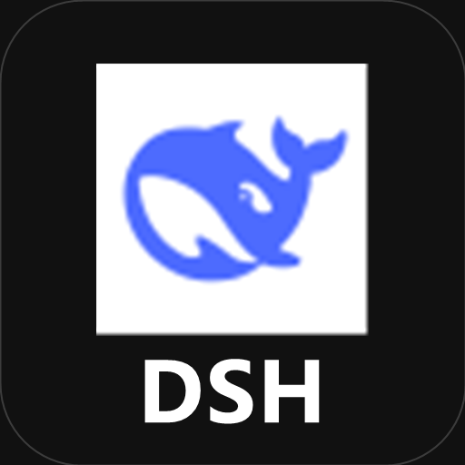
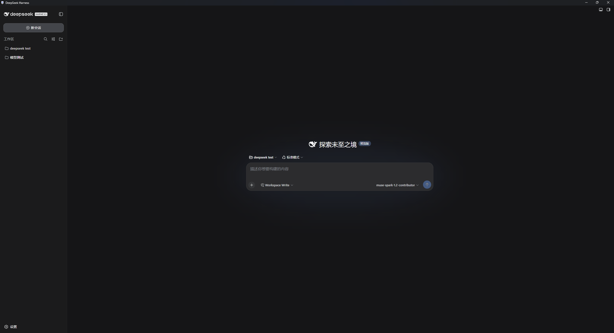
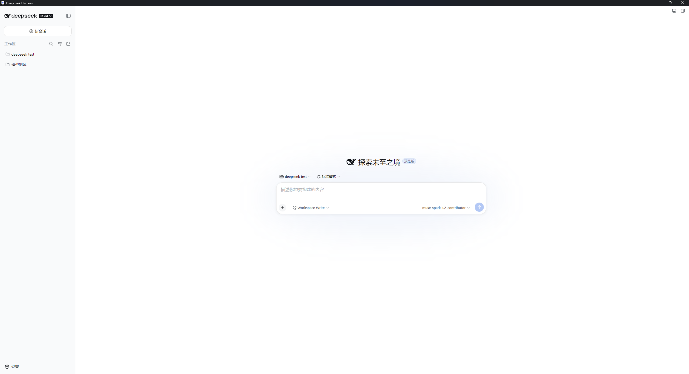
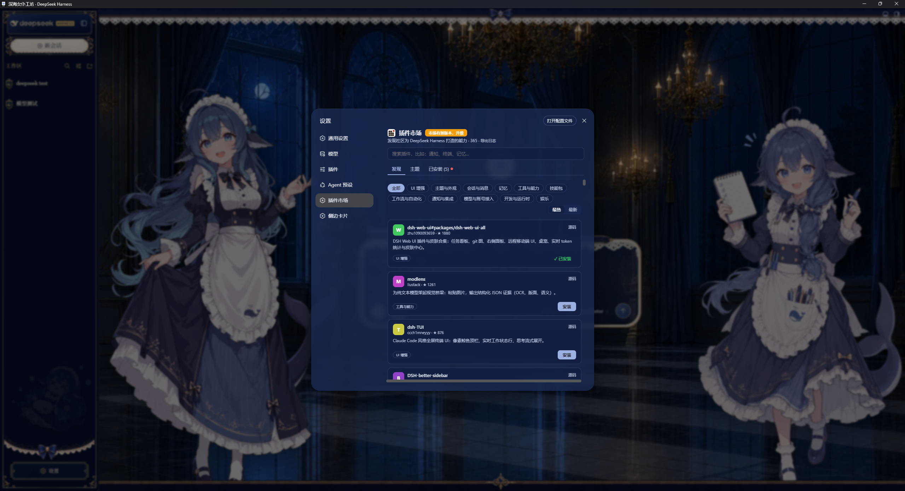

# dsh-desktop-shell

<p align="center">
  
  <a href="https://dshfind.com/zh/plugins/SZMY-haruhi/dsh-desktop-shell?ref=badge" style="display: inline-block; vertical-align: middle;">
    
  </a>
</p>

[English](README.en.md) | 中文

DeepSeek Harness（dsh）桌面客户端 / 纯 Electron 外壳。
不打包任何 dsh 代码。启动时执行 `npx --yes @deepseek-ai/dsh@latest web --no-open`，读取 CLI 打印的 `dsh web:` 行（形如 `http://127.0.0.1:3080/?token=...`），再把这个带启动 token 的地址载入窗口。自 0.1.2 起裸地址不会换到会话 cookie，页面会 401。对所有插件完全透明，官方更新无需重新编译。


## 界面预览

纯壳对插件透明——以下为 `DSH Desktop` 窗口化运行 `dsh web` 的实拍，皮肤与插件市场均原样生效。

| 深色 | 浅色 |
|---|---|
|  |  |

**社区皮肤** [`dsh-web-ui-all`](https://github.com/zhu1090093659/dsh-web-ui/tree/main/packages/dsh-web-ui-all)（全量皮肤包）—— 纯壳直接加载，无需修改：


**插件市场** [`dsh-market`](https://github.com/dsh-market/dsh-market#readme) —— 打包版对 `dsh-plugin` 生态无影响，可正常浏览/安装：



## 运行

### 前置

- `Node.js ^22.19 || >=24`（`dsh` 本体要求；外壳也用它来拉起 `npx`）
- 推荐 `pnpm@11.7.0`，`npm`/`yarn` 亦可

### 发行版

下载 `DSH Desktop Shell Setup 0.1.1.exe` 安装后双击 `DSH Desktop Shell`，首次启动自动 `npx` 拉取 `@deepseek-ai/dsh@latest` 并打开 Web UI。

### 源码

```sh
git clone https://github.com/<you>/dsh-desktop-shell.git
cd dsh-desktop-shell/dsh-desktop-electron
pnpm install
pnpm start        # 调试：拉起本地 npx dsh web
pnpm run build    # 打包：electron-builder → dist/DSH Desktop Shell Setup 0.1.1.exe（~80MB，含 Chromium）
```

无需克隆 `deepseek-harness`。`npx --yes @deepseek-ai/dsh@latest web --no-open` 是唯一真源，对应上游 `dsh web --no-open`（[web-app 手册](https://github.com/deepseek-ai/deepseek-harness/blob/master/packages/bundle/web-app/README.md)）。

## 架构

`main.js` 负责 spawn（`--no-open`，管道读取 stdout/stderr）→ 匹配 `dsh web: http(s)://…?token=…` → BrowserWindow 加载该地址。关窗口只藏到托盘；托盘「退出」或进程退出时才结束子进程。与所有 `dsh-plugin` 无冲突（透明壳）。

## 配置

无配置文件。`main.js` 常量：启动命令 `npx --yes @deepseek-ai/dsh@latest web --no-open`、等待 `dsh web:` 行 180s、窗口 1280×800。默认监听仍是上游的 `127.0.0.1:3080`，实际打开的是 CLI 打印的 URL。

## 模型可见性

无。作为独立宿壳，不贡献 prompt 片段、工具 schema 或会话事件；模型可见行为完全由被拉起的 `dsh` 进程及其插件决定。

## 已知限制

同英文版 `Known Limitations`，含固定端口、单实例、无托盘、轮询就绪、Chromium 体积、Windows 优先。

## 许可

[MIT](LICENSE)，与上游一致。

---

## 作者

<a href="https://tonkatsu258.vercel.app/">
  
</a>

**感谢 Star ❤️** — [tonkatsu258](https://tonkatsu258.vercel.app/) · [个人网站](https://tonkatsu258.vercel.app/)
